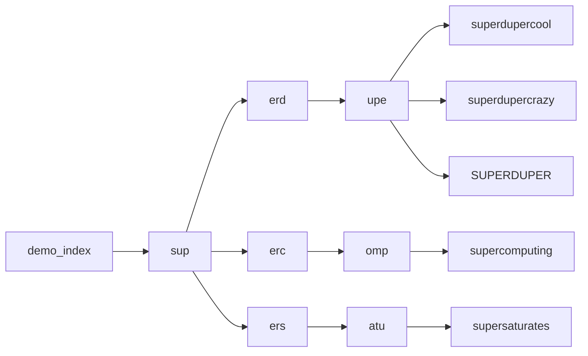

# Prefix Index

A library crate to implement a prefix index in your holochain zomes.

A prefix index is useful for typeahead "search" functionality.

## Usage

1. Include the hc_prefix_index crate in your coordinator zome's Cargo.toml:

```toml
[dependencies]
...
hc_prefix_index = "0.15.0"
```

2. Include the hc_prefix_index crate in your integrity zome's Cargo.toml

3. Create a link type for the index:
```rust
#[hdk_link_types]
enum LinkTypes {
    PrefixIndex
}
```

4. Add the prefix index validation functions to your validate match arms for
   links of `LinkTypes::PrefixIndex`:

```rust
match op.flattened::<EntryTypes, LinkTypes>()? {
    FlatOp::Link(op_link) => match op_link {
        OpLink::CreateLink { link_type, action } => match link_type {
            LinkTypes::PrefixIndex => make_index()?.validate_create_link(action),
            // ...
        },
        // Delete validation reads no index configuration, so there is no need
        // to construct a PrefixIndex here.
        OpLink::DeleteLink { original_action, action, .. } =>
            PrefixIndex::validate_delete_link(action, original_action),
    },
    // ...
}
```

5. Setup a prefix index

```rust
use hc_prefix_index::PrefixIndex;

let index = PrefixIndex::new("demo_index".into(), LinkTypes::PrefixIndex, 3, 3)?;
```

6. Add some results to the index:
```rust
index.add_result("superdupercool".into())?;
index.add_result("superdupercrazy".into())?;
index.add_result("supercomputing".into())?;
index.add_result("supersaturates".into())?;
index.add_result("SUPERDUPER".into())?;
```

7. This will generate an index of links for the strings as follows:



8. Now you can search the index using DFS. Reads take a `GetStrategy`, which
   decides whether they go to the network or only to local storage:
```rust
index.get_results("sup".into(), 10, GetStrategy::Network)?;
// [
//   "supercomputing",
//   "SUPERDUPER",
//   "superdupercool",
//   "superdupercrazy",
//   "supersaturates",
// ]

let res2 = index.get_results("superduper".into(), 10, GetStrategy::Network)?;
// [
//   "SUPERDUPER",
//   "superdupercool",
//   "superdupercrazy",
//   "supercomputing",
//   "supersaturates",
// ]

let res2 = index.get_results("superduper".into(), 2, GetStrategy::Network)?;
// [
//   "SUPERDUPER",
//   "superdupercool",
//   "superdupercrazy",
// ]

let res2 = index.get_results("walrus".into(), 10, GetStrategy::Network)?;
// [ ]
```

## Removing results

```rust
let deleted = index.remove_result("superdupercool".into(), GetStrategy::Network)?;
```

`remove_result` deletes only the calling agent's own links, because validation
lets an author delete only what they authored. It returns how many links it
deleted, which describes the call rather than the state of the index afterwards:
`0` means this agent authored none of the links the call could see (the result
was never indexed, or another agent indexed it first — path creation is
deduplicated across authors, so the second agent to add a result authors no
links for it). A non-zero count does not guarantee the result is gone either,
since an agent racing the same add authors duplicate links that keep it indexed.

## Gotchas

All strings beneath the top-level prefix of your search query will be returned (ordered by similarity, then alphabetically), so make sure to specify a "limit" to reduce the number of returned results.

Letter casing is *ignored* in the index, but is *preserved* in the results.

An index name must not contain `.`: names are parsed through the path DSL, where
a dot splits the name into multiple path components.

An index is shared, not per-agent: any agent may add any string, and the agent
who authored a result's links controls its lifetime. There is no reference
counting.

## Todo
- [ ] Cursor-based pagination (i.e. give me next 5 results after "supercomputer" for the search query "superduper")
- [ ] Specify min depth to search the prefix index (i.e. for the query "supercomputer" min depth 0 would return all results, min depth 1 would return all results under 'prefix_index.sup', min depth 2 would return all results under 'prefix_index.sup.erc', etc.)
- [ ] Custom Elements for typeahead search using prefix index 
- [ ] Validation of index path components 3+ to fit expected structure (currently not possible with holochain validation of each indiviudal link and with links being Actions)
- [ ] Private indexes (currently not possible with holochain links being Actions)

## Running the tests

```bash
nix develop
npm install
npm test
```
